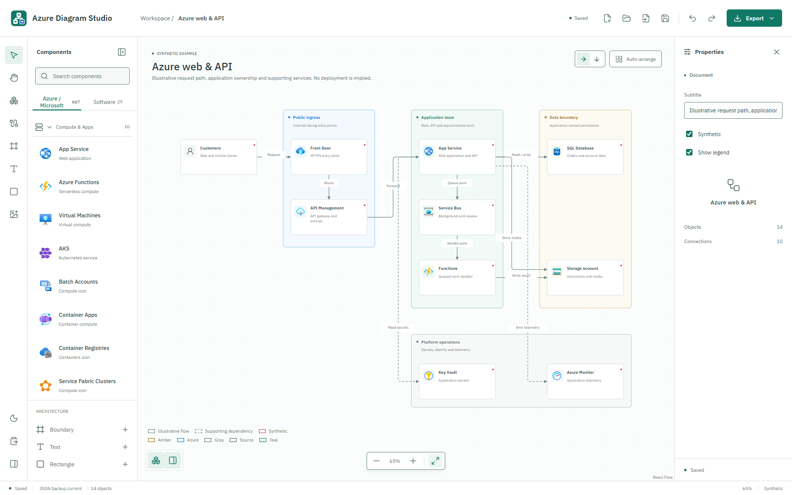
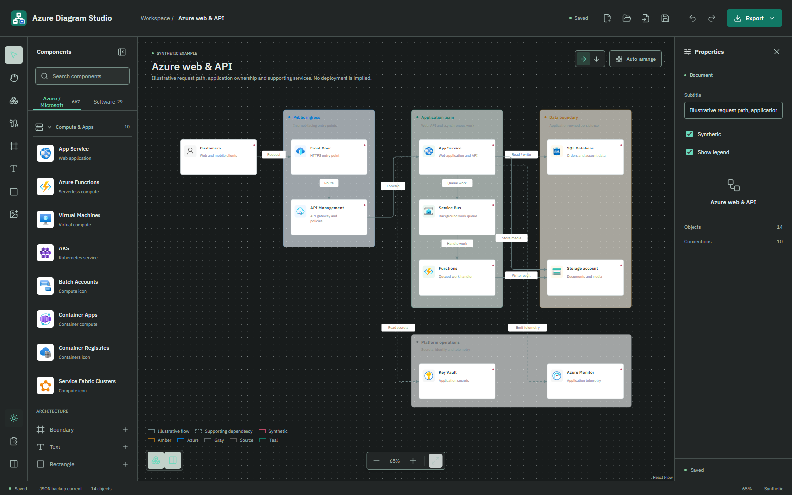
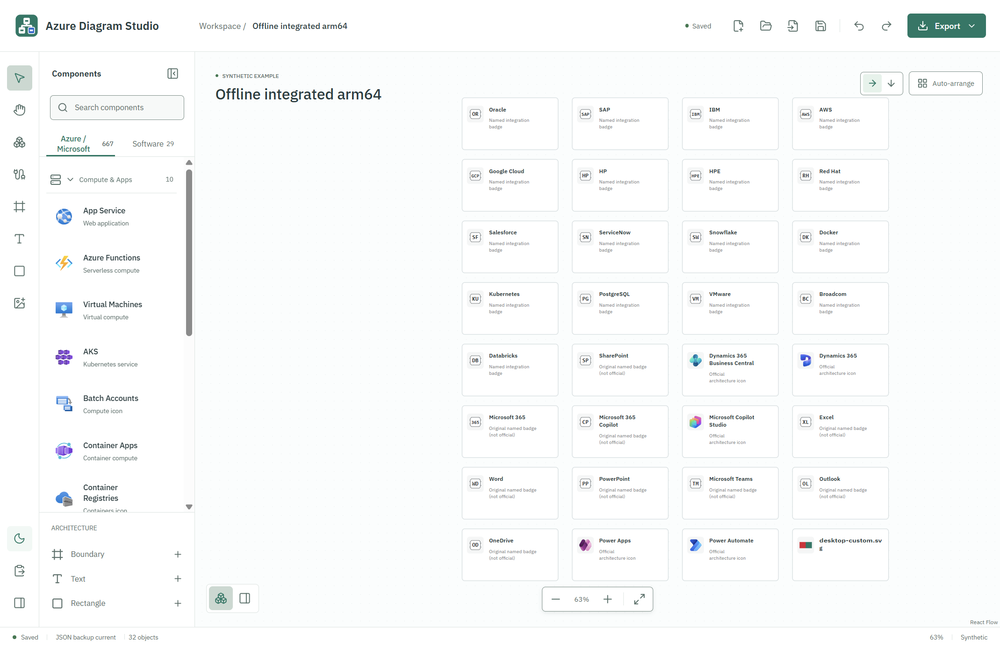
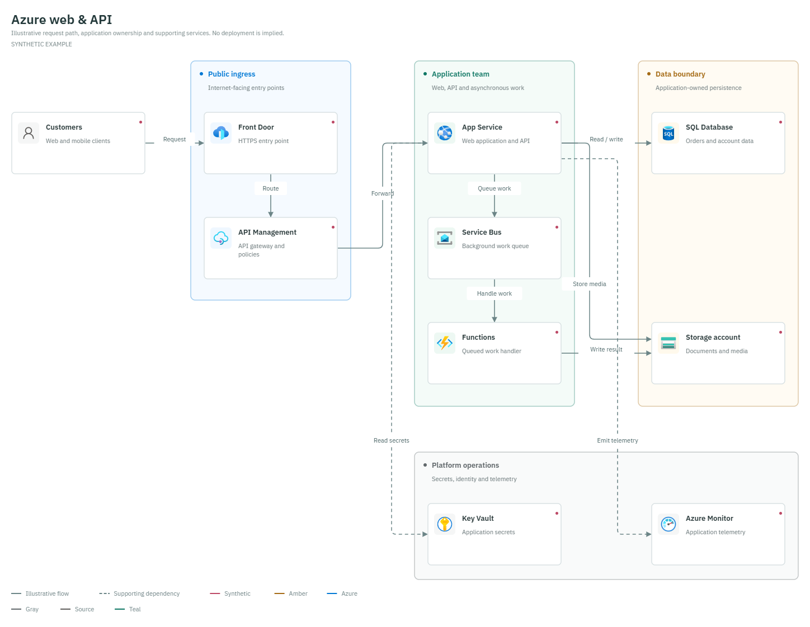
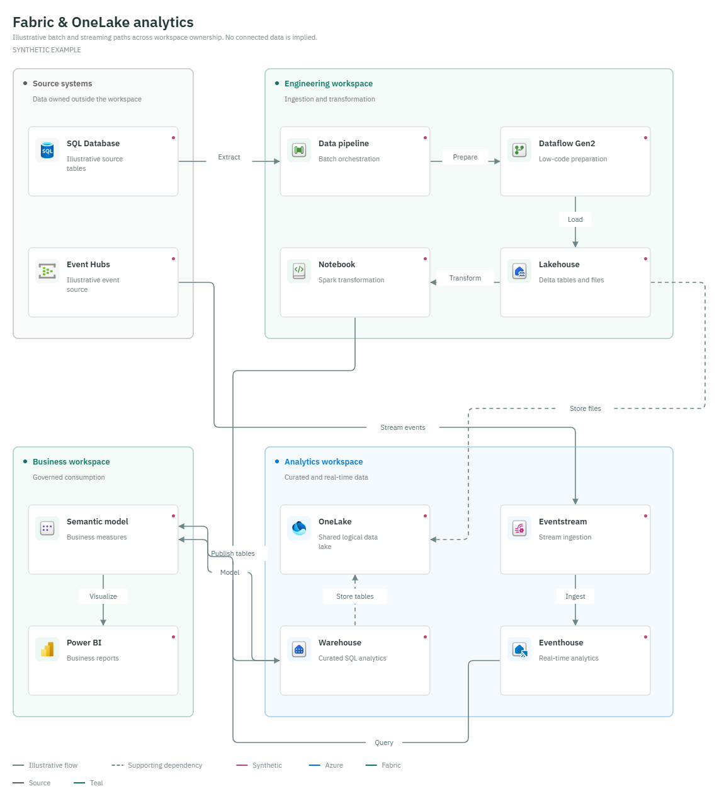
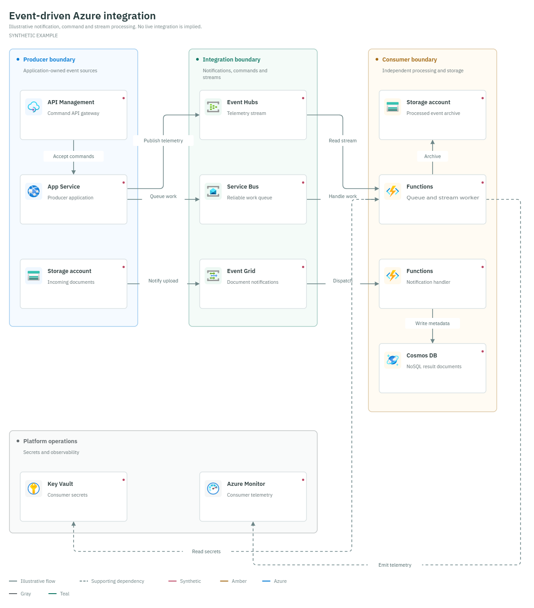
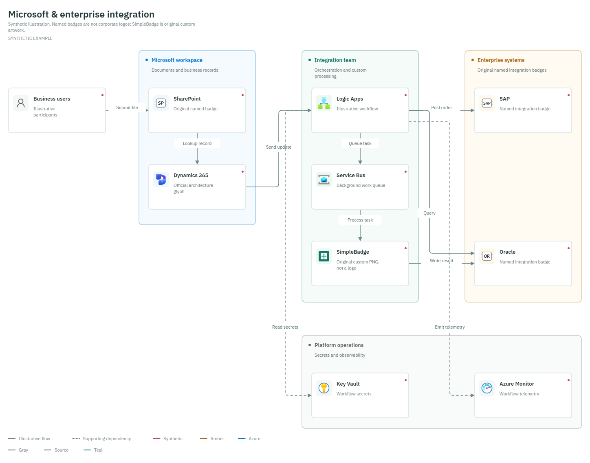

#  Azure Diagram Studio



A local architecture editor for Azure, Microsoft Fabric, Microsoft applications and software systems. Draw with architecture glyphs, clearly identified named badges or your own authorized images; describe ownership boundaries, connect components and export without a cloud account. The public source repository is [vespassassina/AzureDiagramStudio](https://github.com/vespassassina/AzureDiagramStudio).

- Searchable Azure/Fabric catalogs, 14 Microsoft app entries (5 official architecture glyphs, 7 official product PNGs, and 2 original named badges), and generic software components.
- A vendor icon set of 17 bundled PNG product icons, including Oracle, SAP, IBM, AWS, Google Cloud, HP and HPE as distinct identities.
- Custom icon import from SVG, PNG, JPEG, GIF or WebP, embedded as a safe normalized PNG in the editable document.
- Editable boundaries, annotations, connector labels, statuses and legends.
- Explicit ELK Auto-arrange, undo/redo and selection clipboard.
- Local autosave, editable JSON backups and separate skill-JSON import.
- Self-contained SVG with native text, embedded icons and font; PNG at 1x or 2x.
- Local light/dark editor theme; document and export colors stay unchanged.



## New Document, About And Help

A fresh workspace starts with an **empty canvas** and the unified **New diagram**
picker. **Blank** is the default; choose it to stay empty or explicitly choose
one of eleven templates. Escape or Close also leaves the fresh canvas empty.
The same New diagram button and Commands action reopen that picker for existing
work. Autosaved diagrams recover unchanged without an automatic picker, including
saved empty diagrams.

Version 0.3.0 adds **About** beside the question-mark **Help** button in
the left tool rail. About shows the product version from package metadata,
plain-text project/documentation references, identity and artwork-rights information, and
the reminder to keep editable JSON backups. Close it or press Escape to return
to the same diagram; it is also available in read-only sessions.

The ten-step Help guide now describes fresh empty startup, all eleven starters,
Markdown Edit/Preview and temporary presentation markup. See the [short manual](docs/manual.md#about-source-only)
for About and [first-use guidance](docs/manual.md#first-use-ui-guide).
These features are included in the Windows **0.3.0** downloads below.
Historical 0.2.0 executables remain unchanged.

## Windows 0.3.0

The local MCP integration described below is a newer **source-only** feature;
the existing 0.3.0 downloads have not been rebuilt with it.

[Azure Diagram Studio 0.3.0 for Windows](https://github.com/vespassassina/AzureDiagramStudio/releases/tag/0.3.0)
is the current stable release, with About, empty startup, the unified picker and
updated guidance, alongside the existing editing, presentation and export tools.

| Your PC | Download |
| --- | --- |
| Windows on ARM / Snapdragon | [ARM64 portable EXE](https://github.com/vespassassina/AzureDiagramStudio/releases/download/0.3.0/Azure-Diagram-Studio-0.3.0-win-arm64-portable.exe) |
| Windows on Intel / AMD | [x64 portable EXE](https://github.com/vespassassina/AzureDiagramStudio/releases/download/0.3.0/Azure-Diagram-Studio-0.3.0-win-x64-portable.exe) |

[SHA256 checksums](https://github.com/vespassassina/AzureDiagramStudio/releases/download/0.3.0/SHA256SUMS.txt)
| [Source provenance](https://github.com/vespassassina/AzureDiagramStudio/releases/download/0.3.0/SOURCE-PROVENANCE.json)
| [Verification report](docs/verification/DGM-130.md)

Both portables are **unsigned**. Independent exact-EXE checks passed on native
Windows ARM64 and x64 under ARM64 emulation, not native Intel/AMD hardware.
Complete anonymous public downloads matched the sealed hashes; provenance and
checksum content passed independent verification after a retained metadata repair.
Follow organizational policy and do not disable SmartScreen or other protections.
The exact source is tagged `0.3.0` at
`96c3e3f6c497eb008c767efd38f59f00f91d7cea`.
No automatic updater or profile migration is provided: keep **Save JSON**
backups and use **Open JSON** to transfer editable work.

## Local MCP Server (New Source)

Source version **0.4.0** includes this integration; its Git tag is a source
milestone, not a new Windows binary release.

The desktop source adds a local MCP endpoint that starts automatically while
Azure Diagram Studio is open. In **Settings**, use **Copy MCP address** and
**Copy access token** to configure an HTTP-capable MCP client on the same
computer. The access token changes when the app restarts.

Tools inspect the committed diagram, search the component catalog, list templates
and read app information, and can create and edit diagrams through the same
validated session/history/autosave path as the UI. Edits are atomic and undoable;
stale requests or active user interactions are rejected rather than overwritten.
Unfinished drafts are not shared or force-committed. There is no shell execution
or arbitrary file access. The listener binds to loopback only; authenticated
requests and Host/Origin validation protect against accidental browser access.

See [MCP setup and limits](docs/manual.md#local-mcp-server-new-source).
No Claude, Scout or GitHub Copilot configuration is silently modified.
Client-specific compatibility requires an actual successful tool call, not just
pasting an address. Browser-only builds and the published 0.3.0 EXEs do not
provide this new desktop server.

## Historical Windows 0.2.0

[Azure Diagram Studio 0.2.0 for Windows](https://github.com/vespassassina/AzureDiagramStudio/releases/tag/windows-v0.2.0)
is the previous **final stable release**, not an RC or prerelease. It includes Help,
quick delete, larger connection handles, Escape cancellation, context actions,
temporary presentation markup, eleven guided starters, saved Markdown descriptions
and the resizable Edit/Preview sidebar, including presentation fullscreen.

| Your PC | Download |
| --- | --- |
| Windows on ARM / Snapdragon | [ARM64 portable EXE](https://github.com/vespassassina/AzureDiagramStudio/releases/download/windows-v0.2.0/Azure-Diagram-Studio-0.2.0-win-arm64-portable.exe) |
| Windows on Intel / AMD | [x64 portable EXE](https://github.com/vespassassina/AzureDiagramStudio/releases/download/windows-v0.2.0/Azure-Diagram-Studio-0.2.0-win-x64-portable.exe) |

[SHA256 checksums](https://github.com/vespassassina/AzureDiagramStudio/releases/download/windows-v0.2.0/SHA256SUMS.txt)
| [Source provenance](https://github.com/vespassassina/AzureDiagramStudio/releases/download/windows-v0.2.0/SOURCE-PROVENANCE.json)
| [Verification report](docs/verification/DGM-125.md#final-stable-publication---2026-10-17)

Both executables are **unsigned**. ARM64 was tested natively; x64 was tested under
Windows ARM64 emulation, not on native Intel/AMD hardware. Complete anonymous
downloads of all four assets matched their sealed SHA256 values. SmartScreen,
organizational policy and human/other-platform qualification remain separate;
do not disable protections. Source and automatic tag archives identify commit
`7783b384e5a46160bdd340112c924f019e0c7830`. There is no automatic updater or
profile migration: keep **Save JSON** backups and use **Open JSON** to transfer
diagrams. Older versions may discard newer description metadata when resaving.

For signing options and how to obtain a publisher identity, see
[Windows signing and certificates](docs/manual.md#windows-signing-and-certificates).
Nothing in the current About screen changes the signature of a downloaded EXE.
The PO is collecting informal colleague feedback; no recruited participant or
timed novice trial is required. Report the version, architecture and reproduction
steps when sharing a problem; platform evidence limits above still apply.

## Historical Windows ARM64 Prerelease

[0.2.0 ARM64 candidate](https://github.com/vespassassina/AzureDiagramStudio/releases/tag/arm64-v0.2.0) is published with four checksum-verified assets. It is unsigned and ARM64-only, not a stable or general platform qualification. The independently tested EXE is 403,328,830 bytes.

[Download ARM64 EXE](https://github.com/vespassassina/AzureDiagramStudio/releases/download/arm64-v0.2.0/Azure-Diagram-Studio-0.2.0-win-arm64-portable.exe) | [SHA256 checksums](https://github.com/vespassassina/AzureDiagramStudio/releases/download/arm64-v0.2.0/SHA256SUMS.txt) | [Source candidate ZIP](https://github.com/vespassassina/AzureDiagramStudio/releases/download/arm64-v0.2.0/Azure-Diagram-Studio-0.2.0-source-candidate.zip) | [Source provenance](https://github.com/vespassassina/AzureDiagramStudio/releases/download/arm64-v0.2.0/SOURCE-PROVENANCE.json)

The attached **source candidate ZIP is authoritative** for this binary. The tag anchors a remote base only; GitHub's automatic source archives do not contain the verified working-tree candidate, and no source branch was pushed. See [publication verification](docs/verification/release-0.2.0-arm64.md) for full hashes and boundaries. Native ARM64 automation passed 10 groups across three sessions; physical offline, downloaded-file SmartScreen/policy, human Teams/Office/novice and other-platform checks remain open. Follow your organization's policy; do not disable protections.

## Historical Windows 0.1.0 Portable

[Version 0.1.0 is published](https://github.com/vespassassina/AzureDiagramStudio/releases/tag/v0.1.0). Both portable files and the checksum manifest were uploaded and read back with matching sizes and SHA256 digests.

| Your PC | Release asset name |
| --- | --- |
| Windows on ARM, including Snapdragon | [Download ARM64 portable EXE](https://github.com/vespassassina/AzureDiagramStudio/releases/download/v0.1.0/Azure-Diagram-Studio-0.1.0-win-arm64-portable.exe) |
| Windows on Intel or AMD | [Download x64 portable EXE](https://github.com/vespassassina/AzureDiagramStudio/releases/download/v0.1.0/Azure-Diagram-Studio-0.1.0-win-x64-portable.exe) |

The portable packages bundle the complete app, Chromium runtime, glyphs, badges, font and layout worker for offline use, without Node.js, a local server or cloud sign-in. They have no auto-update service. Files are approximately 403-404 MB because the portable wrapper uses store-only compression. ARM64 was tested natively; x64 was tested under Windows ARM64 emulation, not certified on native Intel/AMD hardware.

Actual packaged offline checks passed for launch, five image formats, unsafe-image rejection, themes, bundled-worker layout/undo, JSON/SVG/PNG output, autosave/relaunch and moving the executable. Default production launch exposed no debug listener. This capture is from the packaged ARM64 app with networking disabled, not the development browser:



Before launching a downloaded executable, compare its SHA256 with [SHA256SUMS.txt](https://github.com/vespassassina/AzureDiagramStudio/releases/download/v0.1.0/SHA256SUMS.txt):

```powershell
Get-FileHash '.\Azure-Diagram-Studio-0.1.0-win-x64-portable.exe' -Algorithm SHA256
```

These files are unsigned and may trigger Windows SmartScreen. Verify the source and checksum; follow your organization's policy. Do not disable SmartScreen, antivirus or other protections. Native save-dialog appearance and SmartScreen UX remain manual checks.

Local autosave is not a transferable backup. Use **Save JSON** before moving computers, clearing browser/profile data or removing the application. Browser and desktop storage are separate; transfer existing localhost diagrams with **Save JSON**, then **Open JSON** in the desktop app. See the [short manual](docs/manual.md).

## Examples

The four illustrated examples below are synthetic illustrations, not deployed systems, security guarantees or live integrations. Every component is marked **Synthetic**. The app's **New diagram** chooser also includes seven Microsoft Learn adaptations, for eleven bundled starters in total; see the [starter guide](docs/manual.md#start-with-an-example). Open the native JSON with **Open JSON** to edit; SVG and PNG are reusable pictures, not editable document backups.

[View all four examples together](docs/images/examples-contact-sheet.png).

### Azure Web & API



[Editable JSON](examples/azure-web-app.json) | [SVG](docs/images/azure-web-app.svg) | [PNG](docs/images/azure-web-app.png)

### Fabric & OneLake Analytics



[Editable JSON](examples/fabric-onelake.json) | [SVG](docs/images/fabric-onelake.svg) | [PNG](docs/images/fabric-onelake.png)

### Event-Driven Azure Integration



[Editable JSON](examples/event-driven.json) | [SVG](docs/images/event-driven.svg) | [PNG](docs/images/event-driven.png)

### Microsoft & Enterprise Integration



[Editable JSON](examples/enterprise-integration.json) | [SVG](docs/images/enterprise-integration.svg) | [PNG](docs/images/enterprise-integration.png)

SharePoint uses its bundled Microsoft product PNG; Dynamics 365 uses its published architecture glyph. SAP and Oracle use bundled vendor PNGs. **SimpleBadge** is original sample artwork, not a corporate logo. Its [SVG source](examples/simple-badge.svg) and [PNG](examples/simple-badge.png) can be used to try **Import custom icon**. The native example embeds the normalized PNG, so it needs no external image file.

## Build From Source

Install Node.js and npm for source development; dependency installation needs network access the first time. From the repository root:

```powershell
cd app
npm ci
npm test
npm run build
npm run dev -- --host 127.0.0.1
```

Open the URL printed by Vite. The browser build stores data in that browser's origin/profile. For built-file preview, use `npm run preview -- --host 127.0.0.1` after building.

The examples are generated with the app's native parser, canonical catalog, shared renderer and real ELK layout, followed by curated page geometry. After installing app dependencies, run `node docs/tools/generate-examples.mjs` from the repository root to regenerate JSON/SVG/PNG, or append `--check` to validate them. Checks use installed Microsoft Edge. Add `--screenshot` with `DGM_DOCS_URL` set to the running branded app to capture both themes in a fresh isolated context, without touching your browser data.

## Notices

Azure Diagram Studio is independent, not a Microsoft product and not endorsed by any named organization. Its original [logo](app/public/branding/logo.svg) and [favicon](app/public/favicon.svg) are application branding, not Microsoft artwork. Microsoft glyphs retain their architecture/training/documentation restrictions; they are not unrestricted marketing assets and no blanket sublicensing permission is asserted. Retain the [third-party notices](app/public/THIRD-PARTY-NOTICES.md), [Microsoft application provenance](app/public/MICROSOFT-APP-NOTICES.md), [vendor badge rights/source qualifications](app/public/VENDOR-NOTICES.md) and [original license/terms files](app/public/licenses/).

Named badges do not establish logo permission, affiliation or tested compatibility. Import only artwork you own or are authorized to use; responsibility for uploaded content remains with its contributor. No open-source license has been selected for this project: a public repository is not itself a license grant.

PowerPoint insertion fidelity and uncoached novice usability have not been manually accepted; the example pictures do not establish those results. Formal participant trials were removed from the active plan by the PO; optional colleague feedback is not a certification pass.

## Release Downloads

- [Latest final Windows 0.2.0 release](https://github.com/vespassassina/AzureDiagramStudio/releases/tag/windows-v0.2.0)
- [0.2.0 Windows ARM64 portable](https://github.com/vespassassina/AzureDiagramStudio/releases/download/windows-v0.2.0/Azure-Diagram-Studio-0.2.0-win-arm64-portable.exe)
- [0.2.0 Windows x64 portable](https://github.com/vespassassina/AzureDiagramStudio/releases/download/windows-v0.2.0/Azure-Diagram-Studio-0.2.0-win-x64-portable.exe)
- [0.2.0 SHA256 checksum manifest](https://github.com/vespassassina/AzureDiagramStudio/releases/download/windows-v0.2.0/SHA256SUMS.txt)
- [0.2.0 exact source provenance](https://github.com/vespassassina/AzureDiagramStudio/releases/download/windows-v0.2.0/SOURCE-PROVENANCE.json)
- [0.2.0 ARM64-only prerelease and authoritative source ZIP](https://github.com/vespassassina/AzureDiagramStudio/releases/tag/arm64-v0.2.0)
- [0.2.0 ARM64 candidate SHA256 checksums](https://github.com/vespassassina/AzureDiagramStudio/releases/download/arm64-v0.2.0/SHA256SUMS.txt)
- [Windows ARM64 portable](https://github.com/vespassassina/AzureDiagramStudio/releases/download/v0.1.0/Azure-Diagram-Studio-0.1.0-win-arm64-portable.exe)
- [Windows x64 portable](https://github.com/vespassassina/AzureDiagramStudio/releases/download/v0.1.0/Azure-Diagram-Studio-0.1.0-win-x64-portable.exe)
- [SHA256 checksum manifest](https://github.com/vespassassina/AzureDiagramStudio/releases/download/v0.1.0/SHA256SUMS.txt)
- [Release notes and limitations](https://github.com/vespassassina/AzureDiagramStudio/releases/tag/v0.1.0)